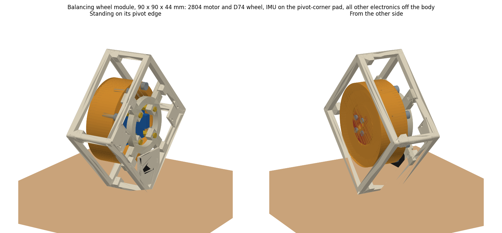
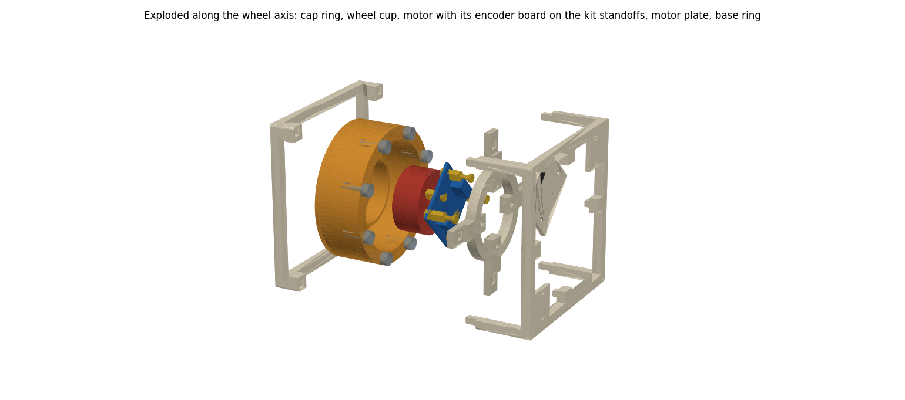

# Balancing wheel module (2804 motor)

A thin 90 x 90 x 44 mm frame that stands on one edge and balances itself with a reaction wheel. Only the motor, the wheel and a small IMU ride on the body. The ESP32, motor driver and power supply stay off the body on a light cable, as in your first sketch. Design status: **CAD checked, nothing printed, nothing run on hardware.** Slicer-ready files and print notes are in [print_ready](print_ready/README.md). **None of the printed parts needs supports**: every downward-facing surface leans 40 degrees or less from vertical.




## What changed from the full cube

Taking the battery, ESP32, driver and lattice off the body let the depth drop from 90 to 44 mm and the mass from 196 g to 138 g. The old two-half cube is kept in `_old_two_half_cube/`.

| | full cube | this module |
|---|---|---|
| Size | 90 x 90 x 90 mm | 90 x 90 x 44 mm |
| Mass | 196 g | 138 g |
| Mgl (gravity torque per radian) | 0.122 N·m | 0.084 N·m |
| Recovers from, at 0.030 N·m | 11.2 degrees | 17.3 degrees |

## What it is

- **Frame:** twelve 5 x 5 mm bars, the four edges along the wheel axis rounded to R1.5. A **base** (end ring, four stubs with tenons, four fins with pegs) and a **cap** (end ring with tapered collars and sockets), glued at four joints.
- **Motor and encoder, as the kit comes:** the listing's photos show the AS5600 board held off the motor's wire end by two brass standoffs (on two of the motor's D19 holes, with the two Phillips screws on the back of the board), and four more brass standoffs nutted into the board's corner slots, sticking out of the back. Those four are the unit's feet. They sit at the outer ends of the corner slots, a 24 mm square (the board drawing's 24), well outside the motor's own D19 holes. The frame never touches the motor's holes: it holds the unit by its feet.
- **Motor plate:** a flat printed cross on the frame's y and z axes, 3.4 mm thick (5.4 inside the ring), with a ring joining the arms. The feet stand on its front face and four M2.5 x 8 screws go in from outside the +x face, through short slots in the arms (about 1 mm of play round the 24 mm square), into the feet. The middle is open for the board's two connectors and the cable. The arm ends glue onto four fins on the base ring, and a peg on each fin (the same 3.4 mm tenon as the frame joints) passes through a square hole in the arm.
- **Wheel:** a D74 cup over the rotor end of the motor, the end without the wires. Its floor screws to the rotor face with 4 x M2.5 on the D16 circle, the 3 mm-deep holes the drawing gives for the rotor. A thin inner wall slides over the spinning can (0.15 mm per side) and stops 1 mm short of the fixed stator base. The rim (r 30 to 37) runs back along the motor and carries the eight M4 weight bolts in its far end. The floor keeps a D6.5 hole for the optional alignment pin.
- **IMU:** on a corner pad at the pivot corner, where it feels the least sway. The board is centred on the vertical diagonal and turned 45 degrees from the frame's bars, so that when the cube balances its edges are vertical and horizontal, and its horizontal axis reads about 0 g there. The 16 mm side is vertical and the 21 mm side horizontal, 28.6 mm above the pivot edge. The pad's two strap slots sit either side of the board, with the strap running across it.
- **Trim pads:** two small pads at the corners across it, for trim weight. These are the corners that move the centre of mass sideways.
- **Cable:** the cable bundle leaves at the pivot corner (tie slots in the IMU pad), close to the pivot edge so its tugs have little leverage.

Stack along x (the wheel axis), in mm:

| x | what |
|---|---|
| -22 to -17 | cap ring |
| -21 to -19.5 | the four M2.5 button heads on the wheel's floor, 1 mm inside the -x face |
| -19.5 to 6.5 | wheel cup: floor -19.5 to -17, inner wall to -7, rim to 6.5; weight-bolt heads to 10.5 |
| -17 to -2 | motor: rotor face at -17, spinning can to -6, fixed stator base (where the leads leave) to -2, magnet boss to 2.5 |
| 5.0 to 6.6 | AS5600 board on the kit's centre standoffs (chip side 7 mm from the wire end, about 1 mm above the magnet); its connectors reach 13.1 |
| 6.6 to 13.6 | the kit's four corner standoffs, the feet |
| 13.6 to 19 | motor plate (3.4 mm, 5.4 inside the ring); the screw heads reach 20.5 |
| 17 to 22 | base ring and its fins; the IMU hangs at x 16.6 to 19.6 on its corner pad |

Everything stays inside the 44 mm depth, and lying on a long face the wheel's rim stays 8 mm above the table.

## Parts

Printed (see the print notes for orientation): `Frame_Base`, `Motor_Plate`, `Frame_Cap`, `Wheel_D74_2804` (four parts, no pin), and small test coupons, `Joint_Test` and the three-file fit test (`Fit_Test_Sockets`, `Fit_Test_Peg`, `Fit_Test_Pins`), to dial in the fits (see "Fits and tolerances").

Buy: the 2804 motor kit (its board, six brass standoffs, four nuts and two screws are all used as they come); 4 x M2.5 x 5 button-head screws (ISO 7380) for the wheel, 4 x M2.5 x 8 button-head screws for the plate, plus spares and thread-lock; 8 x M4 x 12 socket cap screws as wheel weights; two-part epoxy; small zip ties; an MPU6050 breakout; light silicone wire for the cable; and, off the body, the ESP32, a SimpleFOC-compatible three-phase driver and a 12 V supply.

## Assembly

1. Print `Fit_Test_Sockets` and `Fit_Test_Peg` (or `Joint_Test`) first and set the clearances (next section). The tenon should slide into the socket with light pressure.
2. **Leave the motor and encoder as the kit comes.** The board stays on its two centre standoffs and the four corner standoffs stay nutted in the corner slots, at the outer ends. Check the feet sit near the outer ends; the plate's slots allow about 1 mm either way.
3. Tie the IMU to the pivot-corner pad with a zip tie through its two slots. Do this first: once the motor unit is in, the wheel's rim blocks the only way to the pad. Checked in CAD: with the plate in, the IMU still comes out along the wheel axis; with the motor unit in, it cannot.
4. Glue the plate in. Put a thin film of epoxy on the faces of the four fins. Slide the plate in from the open (-x) end, ribbed side first, so the peg on each fin passes through the square hole in the arm end. The arm ends seat flat on the fins and the peg tips end flush with the plate's front face. Nothing touches on the way in (60 mm of travel checked, with the IMU already on its pad), and sliding in 0.5 mm off to one side collides, so the pegs locate the plate. Let it set before the next step.
5. Put the wheel on the rotor end, the end without the wires. The cup's inner wall slides over the spinning can. Optional, for centring: push the headed D6.4 pin from `Fit_Test_Pins` (4 dots) through the floor's centre hole into the motor's hollow shaft first. Screw the floor to the rotor face with four M2.5 x 5 button-head screws on the D16 circle, with thread-lock: that engages 2.5 mm, under the drawing's 3 mm limit, so do not use a longer screw. Pull the pin out, add the eight M4 bolts in the rim's far end, and spin it by hand. It must turn freely: the inner wall stops 1 mm short of the stator base, which does not turn.
6. Slide the motor unit (motor, board, standoffs and wheel) in from the open end until the four brass feet sit on the plate's arms. From outside the +x face, put four M2.5 x 8 button-head screws through the slots in the arms into the feet. That leaves about 2.6 mm of thread in each standoff. Checked in CAD: 60 mm of travel with zero overlap, and a screwdriver reaches every head from outside. The unit can come out again later by undoing these four screws, until the cap goes on.
7. Wires: plug the encoder cable into the board and lead it, and the motor's three leads, out through the open middle of the plate (a 10 mm bundle fits), clear of the wheel's rim, then zip-tie them to the pivot-corner pad so the bundle leaves there. The leads leave the motor's stator base at r 17, inside the rim (r 30), so keep them tied in, away from it.
8. Slide the cap over the wheel, with epoxy in the four sockets, until the collars meet the stubs. It clears the wheel by 3 mm.
9. Balance it: put a gram or two of putty or a washer on a trim pad until it sits still on the edge by hand.

## Fits and tolerances

Every clearance is one number in `mechanical/make_cube_parts.py`. Change it, run `make_cube_parts.py` then `export_print_ready.py`, and the STLs update.

| fit | now | the number to change |
|---|---|---|
| Tenon in socket (the four frame joints, and the four plate pegs in their square holes, which are the same tenon) | tenon 3.4 mm in a 3.5 mm socket: **0.05 mm per side**, measured: socket 2 of `Fit_Test_Sockets` was a perfect fit on your printer (it was 0.20, then 0.10). 0.2 mm spare at the bottom | `CLR_TENON` |
| Lead-in on the tenon tip and the socket mouth | 0.4 mm at 45 degrees, so a snug fit still starts easily | `LEAD_IN` |
| Wheel's centre hole, for the removable alignment pin | D6.5 hole for a D6.4 pin (0.05 mm per side). Nothing is glued in it | `PIN_D` (the hole follows it, pin + 0.1) |
| Alignment pin in the motor's hollow shaft | D6.4 in the drawing's D6.5 bore, so 0.05 mm per side. All four test pins (D6.1 to D6.4) went in, so the largest is the one to use: it leaves the wheel the least play | `PIN_D` |
| Wheel's inner wall over the motor's can | D34.8 over the drawing's D34.5, 0.15 mm per side. If it is tight, sand the bore rather than force it | `CUP_BORE` |
| M2.5 screw holes in the wheel | 2.7 mm (0.1 mm per side) | `M25` |
| Plate's screw slots | 2.8 mm wide, r 15.5 to 17.5 along each arm | `SLOT_R` |
| M4 weight-bolt holes | 3.3 mm, the M4 tap drill; the bolt cuts its own thread | `THREAD_DEPTH` |
| Where the kit puts things (assumed, from the listing) | board's chip side 7 mm from the wire end; corner standoffs 7 mm; feet at the outer ends of the corner slots | `KIT_GAP`, `KIT_FOOT`, `FOOT_R1` |

Rather than guessing, print the fit test. It is three small files (`Fit_Test_Sockets`, `Fit_Test_Peg`, `Fit_Test_Pins`, or all three in `Fit_Test`), and you can print only what you need:

- **`Fit_Test_Sockets`: a board of five square sockets**, marked with 1 to 5 dots, at 0.00, 0.05, 0.10, 0.15 and 0.20 mm clearance per side.
- **`Fit_Test_Peg`: one tenon peg on a flat handle** (the real 3.4 mm tenon with its lead-in). Hold the handle to push the peg into each socket and pull it out again. Pick the tightest socket it slides into with a little hand pressure and no wobble, then set `CLR_TENON` to that. Printers vary a lot, which is why this was measured rather than guessed: on yours the 0.05 socket (2 dots) was the right one. To print less, skip this file and use the tenon on `Joint_Test`, which is the same size.
- **`Fit_Test_Pins`: four pins**, D6.1 to D6.4, each with a D12 head to hold it by and 1 to 4 dots on the head. All four went into the motor's hollow shaft, so the largest, D6.4 (4 dots), is the one used as the alignment jig in assembly step 5.

If the whole print runs loose or tight, you can instead trim it in the slicer: look for the X-Y hole and contour compensation under the Quality or Precision settings. That shifts every fit at once, so use the test coupon to find the right number first and change only one of the two.

## Numbers from the CAD

| | |
|---|---|
| Mass | 138 g: base 16.5, plate 8.5, cap 10.7, wheel cup 27.4, 8 bolts 18.4, motor 40, board 3, kit brass 5, M2.5 screws 2.8, IMU 3, the cable's drag 3 |
| Centre of mass above the pivot edge | 61.6 mm; Mgl = 0.084 N·m |
| Inertia about the edge (without the wheel's own spin) | 6.1e-4 kg·m² |
| Wheel spin inertia | 5.27e-5 kg·m² (wheel 2.7e-5, bolts 2.1e-5, rotor 0.5e-5) |

Printed masses use sliced-mass fractions (frame 0.85, wheel 0.48). **Weigh the parts and update `FILL_*` in `mechanical/make_cube_parts.py`.**

Simulated recovery, with ideal sensing and the torque limit and back-EMF derating at 12 V:

| torque limit | torque / Mgl | recovers from | wheel peak speed |
|---|---|---|---|
| 0.015 N·m | 0.18 | 9.0 deg | 73 rad/s |
| 0.020 | 0.24 | 11.8 deg | 97 rad/s |
| 0.030 | 0.36 | 17.3 deg | 146 rad/s |
| 0.045 | 0.54 | 24.8 deg | 222 rad/s (the motor's no-load speed is about 272 rad/s at 12 V) |

The cup wheel has 37 % more spin inertia than the old flat wheel, so the wheel peaks about 50 rad/s slower for the same recovery. The module is 8 g heavier, which costs half a degree at 0.030 N·m.

At plus or minus 20 % on mass and inertia and plus or minus 5 mm on the centre of mass, all 27 combinations still recover from more than 4 degrees at 0.030 N·m. **This is a feasibility study, not a guarantee:** no sensor noise, delay, friction or quantisation, and SimpleFOC without current sensing makes torque a voltage command.

## Balance, trim and the tether

- The model has the centre of mass on the vertical (0.00 mm off), because the IMU is on the diagonal and the two trim pads are symmetric. That is the CAD, not your print: a real build will be off by some tenths of a millimetre. Each millimetre of sideways offset moves the balance point by 0.93 degrees, and 1 g on a trim pad moves it by 0.30 degrees, so a gram or two of putty trims it.
- **What the IMU should read at balance:** its plane is vertical and its gyro axis is the wheel axis, exactly, because the pad faces along it. With the board square to gravity, the accelerometer's horizontal axis reads about 0 g and its vertical axis about 1 g when the cube balances, and the lean angle is the arctangent of horizontal over vertical, with no 45 degree constant. Which chip axis points up depends on how the breakout's silkscreen faces: check it on the bench by tilting the cube and watching which axis changes sign. The balance point itself is an unstable equilibrium that the wheel holds, so the zero reading is the setpoint, not a place the cube rests by itself.
- The module is stable on its own along its 44 mm edge only up to about 20 degrees of lean in that direction.
- The cable is a disturbance. The model counts 3 g of it. A 0.05 N tug at the pivot corner has a 24 mm arm, which is about 0.0012 N·m, 4 % of the motor's torque. Use thin silicone wire and keep it slack.
- The IMU shares one I2C bus with the AS5600 (addresses 0x68 and 0x36), so the cable carries three phase wires and four I2C wires.

## Checks run

All in `analysis/check_cube.py` and `mechanical/export_print_ready.py`. Each probe has a control that must read above zero.

- **Overhangs:** every printed part checked layer by layer at 0.2 mm against the 40 degree limit: base, plate, cap and joint test read 0.0 mm² in every layer, the wheel cup 0.3 mm² (its thread flank). The base with the plate fused on overhangs 1267 mm² in one layer, so the check can fail.
- **Assembly paths:** the plate slides in from the -x end over 60 mm with the IMU on its pad, then the motor unit (motor, board, standoffs, wheel, bolts) over another 60 mm, then the cap over the wheel, all with zero overlap. Pushed 1 mm too far they overlap by 285, 42 and 81 mm³. The plate slid in 0.5 mm off to one side hits the pegs (8 mm³).
- Static fits between all 12 parts (frame, plate, wheel, motor, board, kit brass, screws, bolts, IMU, cable): every pair 0 mm³, apart from each screw in the part it threads into.
- Wheel spin: the volume the wheel sweeps (floor, inner wall, rim, bolt and screw heads) against everything that does not turn reads 0. The wheel clears the cap ring by 3.0 mm all round, the plate and fin pegs by 3.1 mm, the fixed stator base by 1.0 mm and the board's corners by 6.7 mm. A D84 control hits the ring (341 mm³), and a rim 4 mm longer hits the pegs (224 mm³).
- The board's connectors clear the plate even if they are 7.5 mm tall (the middle of the plate is open); the same block under an arm reads 12 mm³. The plate screws pass through the slots at both ends and the middle (control 3 mm aside: 16.5 mm³), and a 5.2 mm screwdriver reaches all four from outside the +x face without touching the base or the IMU.
- The wheel screws through the floor, a 10 mm cable bundle through the plate's middle, all six tie slots, the alignment pin through the floor into the bore (zero overlap), the tenon joint (0.05 mm clearance, 1.5 mm walls), the plate pegs (zero overlap seated, 2.75 mm walls) and edge rounding (stub cross-section 24.51 mm², expected 24.52).
- Print files: closed meshes, on the bed, volumes equal to the CAD.

## Not verified, or not done

- **The kit's sizes are read off the listing, not measured:** the board's chip side 7 mm from the motor's wire end (two centre standoffs), the corner standoffs 7 mm long and at the outer ends of the corner slots (24 mm square), the board 1.6 mm thick, its connectors about 6.5 mm tall. Measure the motor unit from the rotor face to the ends of the feet: the model has 30.6 mm. If yours is longer, the wheel's screw heads move out of the -x face, which has 1 mm to spare, so tell me the number and I will move the plate. The IMU is a placeholder 21 x 16 x 3 mm.
- **The encoder board carries the motor:** as in the kit, the motor and wheel (about 90 g) hang on the PCB, from its two centre standoffs to its four feet. That is fine for balancing loads; a hard fall could crack the board. The can's real diameter sets the cup's fit (0.15 mm per side drawn).
- **Print and glue:** nothing is printed. The 3.4 mm tenons (1.5 mm walls beside the sockets) and the plate's four glued arm ends (a 3.4 mm peg through each, plus the faces) are untested; PLA creeps, and glued joints are weak points if the module lands hard. Print the joint test before committing.
- **Thread fit:** the M4 holes are drawn 3.3 mm, which depends on your printer's tolerance. Run a bolt in and out once before the final fit.
- **No firmware:** the SimpleFOC torque loop and the lean controller are not written, and nothing about the off-board electronics is designed.
- **One axis only:** it balances on the marked edge. Standing it on another edge moves the IMU away from the pivot and changes its axes.

## Regenerate

```powershell
python mechanical\make_cube_parts.py       # numpy + manifold3d; frame, wheel, cad_numbers.json, viewer_data.json
python mechanical\export_print_ready.py    # print-oriented STLs in print_ready\stl, with the layer-by-layer overhang check on each
python analysis\check_cube.py              # clearance, screw and wire paths, balance, simulated recovery
python analysis\render_cube.py             # numpy + matplotlib; the two preview images
```
