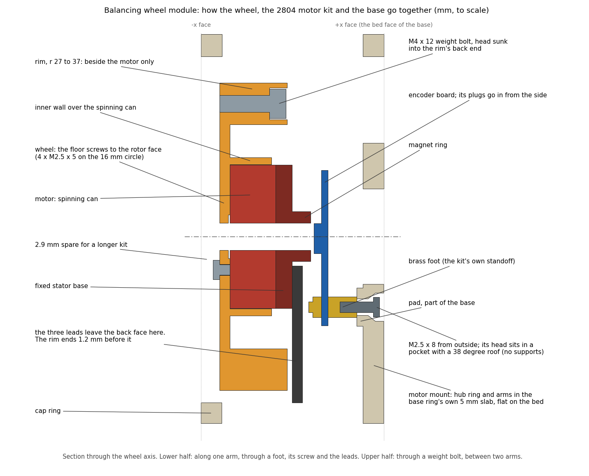
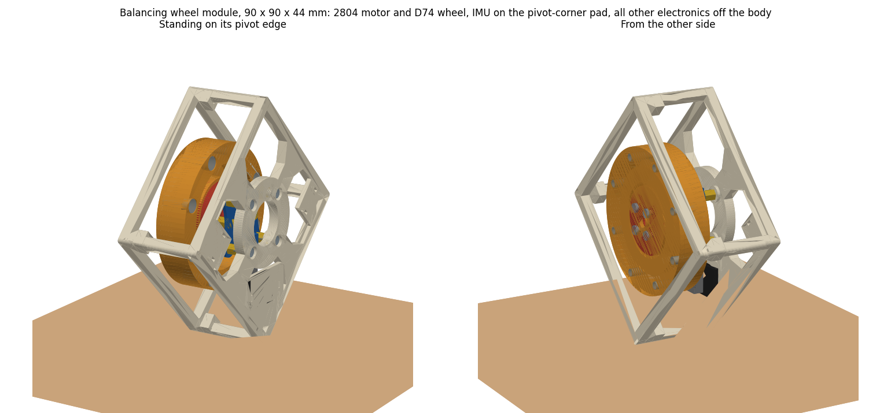
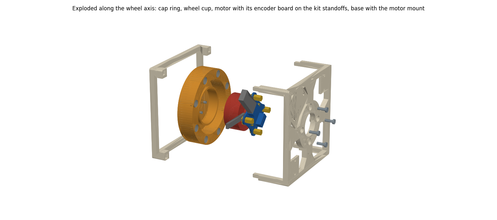

# Balancing wheel module (2804 motor)

A thin 90 x 90 x 44 mm frame that stands on one edge and balances itself with a reaction wheel. Only the motor, the wheel and a small IMU ride on the body. The ESP32, motor driver and power supply stay off the body on a light cable, as in your first sketch. Design status: **CAD checked, nothing printed, nothing run on hardware.** Slicer-ready files and print notes are in [print_ready](print_ready/README.md). **None of the printed parts needs supports**: every downward-facing surface leans 40 degrees or less from vertical.





## What changed in this redesign, and why

The wheel and the motor mount were redrawn against the listing's drawings and photos of your motor kit. The version before this one is kept in `_old_plate_on_fins/`.

| the last version | why it was wrong for this motor | now |
|---|---|---|
| The wheel's rim ran 8.5 mm past the motor's back face and its bolt heads 4 mm further | The motor's three leads come out of that back face, and the encoder's two connectors take their plugs from the side. Both had to cross the space the rim and bolt heads spin in | The rim lies beside the motor only and ends 1.2 mm before its back face. The bolts are sunk into the rim. Nothing that spins is behind the motor |
| The cable was meant to leave through the middle of the plate | The photos show side-entry connectors: the plugs go in from the board's edges, not from behind | The cable leaves sideways towards the pivot corner, in the 15 mm of open space between the wheel and the mount |
| The stack had 1 mm to spare at the -x face | The kit's standoff lengths are not on any drawing; I scaled them off a photo | 2.9 mm to spare, and a shorter unit is no problem at all |
| A separate motor plate glued onto four fins | The glue joint carried the motor and its torque, and it was a fourth part to print and align | The mount is part of the base, in the same 5 mm slab as its ring. No plate, no fins, no pegs, and the only glue left is the frame joint |
| Screw slots 2 mm long under each brass foot | A foot stood on two thin ledges | Slots 1.2 mm long: each foot bears on 12 mm² of pad |
| M4 threads modelled in the wheel (an 8.5 MB file) | Not needed, and the thread flanks were the one place the overhang check was not zero | Plain 3.5 mm holes; the bolts cut their own thread. The file is 0.5 MB and reads 0 |

## What the listing gives, and what is still assumed

From the listing's dimensioned drawings: the motor is D34.5 x 15; the first 11 mm from the rotor face is the spinning can and the last 4 mm is the fixed stator base; the rotor face has 4 x M2.5 on a 16 mm circle, 3 mm deep at most; the back face has 4 x M2.5 on a 19 mm circle and a D12 magnet ring standing 4.5 mm proud; the hollow shaft is D6.5 at the rotor face. The encoder board is 33 x 33 with four corner slots (3.1 x 5) centred on a 24 mm square and two centre slots that land on two of the motor's 19 mm holes; its connectors stand 5.4 mm off the back.

From the listing's photos: the two connectors are side entry, with their mouths at two opposite edges of the board; the four corner standoffs are nutted into the corner slots and open at the back, so a screw goes into each from behind; the three leads come out of the motor's back face beside the magnet ring.

**Assumed, because no drawing gives them:** the two centre standoffs hold the board 7 mm off the motor (the photo scales to 6 to 8.5), and the four feet are 7 mm long (the photo scales to 6 to 7.5; they have to be longer than the 5.4 mm connectors). That makes the unit 30.6 mm from the rotor face to the ends of the feet. The design takes anything up to 33.5 mm.

## Compared with the full cube

Taking the battery, ESP32, driver and lattice off the body let the depth drop from 90 to 44 mm. The old two-half cube is kept in `_old_two_half_cube/`.

| | full cube | this module |
|---|---|---|
| Size | 90 x 90 x 90 mm | 90 x 90 x 44 mm |
| Mass | 196 g | 133 g |
| Mgl (gravity torque per radian) | 0.122 N·m | 0.080 N·m |
| Recovers from, at 0.030 N·m | 11.2 degrees | 17.5 degrees |

## What it is

- **Frame:** twelve 5 x 5 mm bars, the four edges along the wheel axis rounded to R1.5. A **base** (end ring, four stubs with tenons, the motor mount) and a **cap** (end ring with tapered collars and sockets), glued at four joints.
- **Motor and encoder, as the kit comes:** the AS5600 board is held off the motor's back face by two brass standoffs (on two of the motor's 19 mm holes, with the two Phillips screws on the back of the board), and four more brass standoffs, nutted into the board's corner slots, stick out of the back. Those four are the unit's feet. The frame never touches the motor's own holes: it holds the unit by its feet.
- **Motor mount, part of the base:** a hub ring on four arms, on the frame's y and z axes, in the same 5 mm slab as the base ring, so it prints flat on the bed with the rest. Four pads, 1.5 mm proud of the slab, take the four feet. Four M2.5 x 8 screws go in from the outside face, through short slots (0.6 mm either way of the 24 mm square), into the feet: 3.9 mm in the base and 4.1 mm in each foot. The heads sit in pockets, 1.1 mm under the outside face. A pocket's roof tapers at 38 degrees instead of being flat, so it prints without supports; the head stops on that taper.
- **Wheel:** a D74 cup over the rotor end of the motor, the end without the wires. Its floor screws to the rotor face with 4 x M2.5 on the 16 mm circle. A thin inner wall slides over the spinning can (0.15 mm per side) and stops 1 mm short of the fixed stator base. The rim (r 27 to 37, 16.3 mm long) lies beside the motor and ends 1.2 mm before its back face. Eight M4 x 12 weight bolts go into plain holes from the rim's back end; their heads sit in counterbores, 0.3 mm under the surface, and their tips come level with the front. The floor keeps a D6.5 hole for the optional alignment pin, with a shallow relief round it so the floor seats on the rotor face.
- **Wires:** the encoder cable plugs into the connector that faces the pivot corner and runs straight on to that corner, 9.8 mm behind the wheel. The motor's leads leave its back face along one arm. Both are tied to an arm with a zip tie round it, then to the IMU pad.
- **IMU:** on a corner pad at the pivot corner, where it feels the least sway. The board is centred on the vertical diagonal and turned 45 degrees from the frame's bars, so that when the cube balances its edges are vertical and horizontal, and its horizontal axis reads about 0 g there. The 16 mm side is vertical and the 21 mm side horizontal, 28.6 mm above the pivot edge. The pad's two strap slots sit either side of the board, with the strap running across it.
- **Trim pads:** two small pads at the corners across it, for trim weight. These are the corners that move the centre of mass sideways.

Stack along x (the wheel axis), in mm:

| x | what |
|---|---|
| -22 to -17 | cap ring |
| -19.1 to -17.6 | the four M2.5 button heads on the wheel's floor, 2.9 mm inside the -x face |
| -17.6 to -1.3 | wheel cup: floor -17.6 to -15.1, inner wall to -5.1, rim to -1.3 |
| -15.1 to -0.1 | motor: rotor face at -15.1, spinning can to -4.1, fixed stator base to -0.1 (the leads leave this back face), magnet ring to 4.4 |
| 6.9 to 8.5 | AS5600 board on the kit's centre standoffs (chip face 7 mm from the back face, about 0.8 mm above the magnet ring); its connectors reach 13.9 |
| 8.5 to 15.5 | the kit's four corner standoffs, the feet |
| 15.5 to 17 | the four pads the feet stand on |
| 17 to 22 | base ring and motor mount; the mount screws' heads end at 20.9; the IMU hangs at x 16.6 to 19.6 on its corner pad |

Everything stays inside the 44 mm depth, and lying on a long face the wheel's rim stays 8 mm above the table.

## Parts

Printed (see the print notes for orientation): `Frame_Base`, `Frame_Cap`, `Wheel_D74_2804` (three parts, no pin), and small test coupons, `Joint_Test` and the three-file fit test (`Fit_Test_Sockets`, `Fit_Test_Peg`, `Fit_Test_Pins`), which you have already used to set the fits (see "Fits and tolerances").

Buy: the 2804 motor kit (its board, six brass standoffs, four nuts and two screws are all used as they come); 4 x M2.5 x 5 button-head screws (ISO 7380) for the wheel, 4 x M2.5 x 8 button-head screws for the mount, plus spares and thread-lock; 8 x M4 x 12 socket cap screws as wheel weights; two-part epoxy; small zip ties; an MPU6050 breakout; light silicone wire for the cable; and, off the body, the ESP32, a SimpleFOC-compatible three-phase driver and a 12 V supply. This is the same hardware list as before.

## Assembly

1. **Frame:** put epoxy in the cap's four sockets and push it onto the base's four tenons until the collars meet the stubs. The motor mount is already part of the base, so nothing else is glued.
2. **IMU:** tie it to the pivot-corner pad with a zip tie through its two slots. Do this before the motor unit goes in: afterwards the wheel blocks the way to the pad. To reach it later, take the unit out (four screws).
3. **Leave the motor and encoder as the kit comes.** Look at the four feet: each should sit near the middle of its corner slot (a 24 mm square). The base's slots allow 0.6 mm either way. If a foot is further off, loosen its nut, slide it, and tighten it again.
4. **Wheel onto the rotor end**, the end without the wires. The cup's inner wall slides over the spinning can. Optional, for centring: push the headed D6.4 pin from `Fit_Test_Pins` (4 dots) through the floor's centre hole into the motor's hollow shaft first. Screw the floor to the rotor face with four M2.5 x 5 button-head screws on the 16 mm circle, with thread-lock: that engages 2.5 mm, under the drawing's 3 mm limit, so do not use a longer screw. Pull the pin out.
5. **Weight bolts:** drive the eight M4 x 12 into the rim from its back end (the open side of the cup) until each head is just under the surface. The bolts cut their own thread; the first time takes some force. Spin the wheel by hand. It must turn freely.
6. **Plug the encoder cable in now**, into the connector marked VCC GND SCL SDA. It is much easier than after the unit is in the frame.
7. **Unit into the frame:** lower it through the cap ring until the four brass feet stand on the four raised pads, with the plugged connector towards the pivot corner (the corner with the IMU). From the outside face, put four M2.5 x 8 screws through the slots into the feet. **Tighten them snug, not hard:** each head stops on the tapered roof of a printed pocket.
8. **Wires:** lead the encoder cable and the motor's three leads back to the nearest arm and tie them to it with a zip tie round the arm, then tie the bundle to the pivot-corner pad so it leaves there. If your motor's leads point away from the pivot corner, take them along their arm to the ring bar and round the frame.
9. **Balance it:** put a gram or two of putty or a washer on a trim pad until it sits still on the edge by hand. To move wheel weight instead, a 3 mm hex key reaches the weight bolts from outside through the openings in the mount.

## Fits and tolerances

Every clearance is one number in `mechanical/make_cube_parts.py`. Change it, run `make_cube_parts.py` then `export_print_ready.py`, and the STLs update.

| fit | now | the number to change |
|---|---|---|
| Tenon in socket (the four frame joints) | tenon 3.4 mm in a 3.5 mm socket: **0.05 mm per side**, measured: socket 2 of `Fit_Test_Sockets` was a perfect fit on your printer (it was 0.20, then 0.10). 0.2 mm spare at the bottom | `CLR_TENON` |
| Lead-in on the tenon tip and the socket mouth | 0.4 mm at 45 degrees, so a snug fit still starts easily | `LEAD_IN` |
| Wheel's centre hole, for the removable alignment pin | D6.5 hole for a D6.4 pin (0.05 mm per side). Nothing is glued in it | `PIN_D` (the hole follows it, pin + 0.1) |
| Alignment pin in the motor's hollow shaft | D6.4 in the drawing's D6.5 bore, so 0.05 mm per side. All four test pins (D6.1 to D6.4) went in, so the largest is the one to use: it leaves the wheel the least play | `PIN_D` |
| Wheel's inner wall over the motor's can | D34.8 over the drawing's D34.5, 0.15 mm per side. If it is tight, sand the bore rather than force it | `CUP_BORE` |
| M2.5 screw holes in the wheel | 2.7 mm (0.1 mm per side) | `M25` |
| Mount screw slots | 2.8 mm wide, 1.2 mm long (r 16.4 to 17.6) | `SLOT_R`, `SLOT_W` |
| Mount screw head pockets | 5.6 mm wide, 2 mm deep, then a roof at 38 degrees. Takes a head up to D5 | `POCKET_W`, `POCKET_STRAIGHT` |
| M4 weight-bolt holes | plain 3.5 mm; the bolt cuts its own thread. Counterbore D7.6 x 4.3 for the head | `BOLT_HOLE`, `CBORE_D` |
| How far the rim stops before the motor's back face | 1.2 mm | `RIM_SETBACK` |
| What the kit's standoffs measure (assumed) | board's chip face 7 mm from the back face; corner standoffs 7 mm | `KIT_GAP`, `KIT_FOOT` |

The fit test is three small files (`Fit_Test_Sockets`, `Fit_Test_Peg`, `Fit_Test_Pins`, or all three in `Fit_Test`). You have already run it: the 0.05 socket (2 dots) and the D6.4 pin (4 dots) are the ones in the design. Print it again only if you change printer or filament.

If the whole print runs loose or tight, you can instead trim it in the slicer: look for the X-Y hole and contour compensation under the Quality or Precision settings. That shifts every fit at once, so use the test coupon to find the right number first and change only one of the two.

## Numbers from the CAD

| | |
|---|---|
| Mass | 133 g: base 26.9, cap 10.7, wheel cup 22.4, 8 bolts 16.4, motor 40, board 3, kit brass 5, M2.5 screws 2.8, IMU 3, the cable's drag 3 |
| Centre of mass above the pivot edge | 61.5 mm; Mgl = 0.080 N·m |
| Inertia about the edge (without the wheel's own spin) | 5.9e-4 kg·m² |
| Wheel spin inertia | 4.19e-5 kg·m² (wheel 2.05e-5, bolts 1.68e-5, rotor 0.46e-5) |

Printed masses use sliced-mass fractions (frame 0.85, wheel 0.48). Each M4 x 12 bolt is counted as 2.05 g, calculated from its volume. **Weigh the parts and a bolt, and update `FILL_*` and `BOLT_G` in `mechanical/make_cube_parts.py`.**

Simulated recovery, with ideal sensing and the torque limit and back-EMF derating at 12 V:

| torque limit | torque / Mgl | recovers from | wheel peak speed |
|---|---|---|---|
| 0.015 N·m | 0.19 | 9.2 deg | 91 rad/s |
| 0.020 | 0.25 | 12.1 deg | 122 rad/s |
| 0.030 | 0.37 | 17.5 deg | 184 rad/s |
| 0.045 | 0.56 | 24.5 deg | 265 rad/s (the motor's no-load speed is about 272 rad/s at 12 V) |

**The cost of the shorter rim:** the wheel has 20 % less spin inertia than the last version (4.19e-5 against 5.27e-5 kg·m²). A fifth of that drop is bookkeeping, because the last version counted each bolt as 2.3 g. The rest is real. The module recovers from the same lean, because that is set by torque against weight, but the wheel spins faster doing it: 184 rad/s against 146 at 0.030 N·m, and close to the motor's no-load speed at 0.045. The listing rates the motor at 0.03 N·m. To get inertia back, print the wheel with more walls or infill and tell me its weight: that raises the inertia and the weight together.

At plus or minus 20 % on mass and inertia and plus or minus 5 mm on the centre of mass, all 27 combinations still recover from more than 4 degrees at 0.030 N·m. **This is a feasibility study, not a guarantee:** no sensor noise, delay, friction or quantisation, and SimpleFOC without current sensing makes torque a voltage command.

## Balance, trim and the tether

- The model has the centre of mass on the vertical (0.00 mm off), because the IMU is on the diagonal and the two trim pads are symmetric. That is the CAD, not your print: a real build will be off by some tenths of a millimetre. Each millimetre of sideways offset moves the balance point by 0.93 degrees, and 1 g on a trim pad moves it by 0.31 degrees, so a gram or two of putty trims it.
- **What the IMU should read at balance:** its plane is vertical and its gyro axis is the wheel axis, exactly, because the pad faces along it. With the board square to gravity, the accelerometer's horizontal axis reads about 0 g and its vertical axis about 1 g when the cube balances, and the lean angle is the arctangent of horizontal over vertical, with no 45 degree constant. Which chip axis points up depends on how the breakout's silkscreen faces: check it on the bench by tilting the cube and watching which axis changes sign. The balance point itself is an unstable equilibrium that the wheel holds, so the zero reading is the setpoint, not a place the cube rests by itself.
- The module is stable on its own along its 44 mm edge only up to about 20 degrees of lean in that direction.
- The cable is a disturbance. The model counts 3 g of it. A 0.05 N tug at the pivot corner has a 24 mm arm, which is about 0.0012 N·m, 4 % of the motor's torque. Use thin silicone wire and keep it slack.
- The IMU shares one I2C bus with the AS5600 (addresses 0x68 and 0x36), so the cable carries three phase wires and four I2C wires.

## Checks run

All in `analysis/check_cube.py` and `mechanical/export_print_ready.py`. Each probe has a control that must read above zero.

- **Overhangs:** every printed part checked layer by layer at 0.2 mm against the 40 degree limit: base, cap, wheel and joint test read 0.0 mm² in every layer. The same base with flat-roofed screw pockets overhangs 73.8 mm² in one layer, so the check can fail.
- **Static fits** between all 13 parts (base, cap, wheel, motor, board, kit brass, screws, bolts, IMU, its cable, the plug with its cable, the motor leads): every pair 0 mm³, apart from each screw in the part it threads into.
- **Wheel spin:** the volume the wheel sweeps (floor, inner wall, rim with its sunk bolts, screw heads) against everything that does not turn reads 0, with the plug's cable and the motor's leads drawn running straight out to the ring bars, the worst case. The wheel clears the cap ring by 3.0 mm all round, the plane the leads leave in by 1.2 mm, the plug by 9.8 mm and the fixed stator base by 1.0 mm. Controls: a D84 wheel hits the ring (82 mm³); a rim 2 mm longer hits the leads (40 mm³); a rim as long as the last version's cuts right through them (125 mm³).
- **Unit length:** with the motor, board, wheel and wires moved together, a unit 2 mm shorter to 2.9 mm longer than modelled touches nothing and stays inside the 44 mm depth. 3.5 mm longer sticks out (42 mm³), as it should.
- **Assembly paths:** the cap onto the base; the IMU onto its pad through the finished frame; the motor unit, with wheel, bolts, plug and leads, through the cap ring onto the pads over 72 mm: all zero overlap. Pushed 1 mm too far the cap overlaps by 81 mm³ and the unit by 50 mm³.
- **Mount screws:** they pass through the slots at both ends and the middle (control 3 mm aside: 12.8 mm³), and a 4 mm driver reaches all four heads from outside without touching the base or the IMU. A foot anywhere in its board slot bears on 12.4 to 13.1 mm² of pad.
- **Weight bolts:** the holes and head pockets are clear right through, with 1.2 mm of wall inside and outside each pocket. A hex key reaches a bolt head from outside the +x face over 155 of the wheel's 360 degrees, so every bolt can be turned into reach.
- The wheel screws through the floor, the alignment pin through the floor into the bore, all six tie slots, the tenon joint (0.05 mm clearance, 1.5 mm walls) and edge rounding (stub cross-section 24.51 mm², expected 24.52).
- **3D viewer:** opened in a browser and stepped through; the section view matches the stack table. No errors.
- Print files: closed meshes, on the bed, volumes equal to the CAD.

## Not verified, or not done

- **The kit's two standoff lengths are scaled off a photo, not measured.** Measure the motor unit from the rotor face to the ends of the feet: the model has 30.6 mm. Up to 33.5 mm fits inside the 44 mm depth; beyond that the wheel's screw heads stand out of the -x face, which harms nothing but the outline. The IMU is a placeholder 21 x 16 x 3 mm.
- **Which way your motor's leads point.** They leave the back face between two of its 19 mm holes, so along one of the four arms. Which one depends on how the kit was put together. The model draws them along an arm next to the pivot corner.
- **The mount screws' seats:** each head stops on a printed 38 degree taper, not a flat. That holds this 90 g unit, but it will not take hard tightening. Untested.
- **The encoder board carries the motor:** as in the kit, the motor and wheel (about 80 g) hang on the PCB, from its two centre standoffs to its four feet. That is fine for balancing loads; a hard fall could crack the board.
- **The can's real diameter** sets the cup's fit (0.15 mm per side drawn), and whether the shaft end stands proud of the rotor face (the drawing shows it flush; the floor has a 0.4 mm relief in case).
- **The bolts' weight** (2.05 g each) is calculated, not weighed.
- **Print and glue:** nothing is printed. The 3.4 mm tenons (1.5 mm walls beside the sockets) are untested as a glued joint; PLA creeps, and glued joints are weak points if the module lands hard.
- **No firmware:** the SimpleFOC torque loop and the lean controller are not written, and nothing about the off-board electronics is designed.
- **One axis only:** it balances on the marked edge. Standing it on another edge moves the IMU away from the pivot and changes its axes.

## Regenerate

```powershell
python mechanical\make_cube_parts.py       # numpy + manifold3d; frame, wheel, cad_numbers.json, viewer_data.json
python mechanical\export_print_ready.py    # print-oriented STLs in print_ready\stl, with the layer-by-layer overhang check on each
python analysis\check_cube.py              # stack, spin and wire clearance, assembly paths, balance, simulated recovery
python analysis\render_cube.py             # numpy + matplotlib; the two preview images
python analysis\render_section.py          # the labelled section drawing
python analysis\build_assembly_page.py     # the 3D assembly page in ..\..\CTS_Simple_Visulizers\Edge Cube Assembly
```
