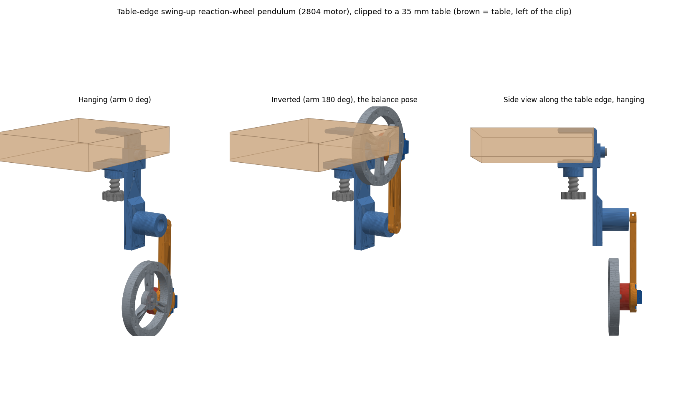
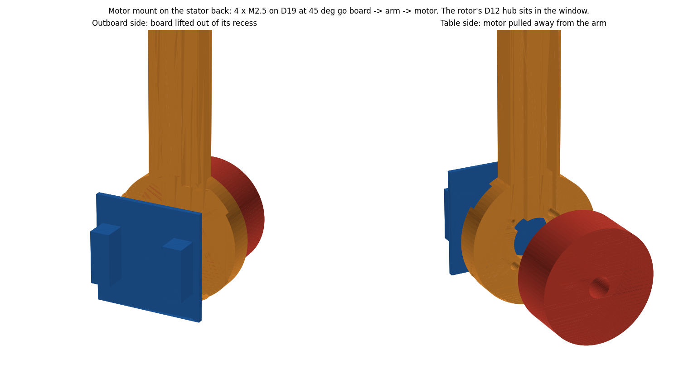

# Swing-up reaction-wheel pendulum, table-edge clip (2804 gimbal motor)

A pendulum that hangs beside a table edge, swings itself up with a reaction wheel and then balances inverted. It clips to the table with the rev3 hook and slider clamp (5 to 45 mm tables) instead of standing on a base. Design status: **CAD checked, nothing printed, nothing run on hardware.**



## Layout

Frame as in `ONE_DOF_RW/String_Rev3/mechanical/table_hook`: table face at x = 0, table top at z = 0, x grows away from the table. The pivot axis is along x, 112 mm below the table top. The arm hangs 100 mm below the pivot (pivot axis to motor axis).

| x (mm) | what |
|---|---|
| 0 to 5 | clip plate (rev3 hook, extended to 146 mm so it reaches the pivot) |
| 4 to 6.4 | slot for the pivot's AS5600 card (slides in from the bottom edge) |
| 7.5 to 12.5 | magnet cap on the rod's rear end, 1.9 mm from the AS5600 chip |
| 12.5 to 17.5, 41 to 46 | two 625ZZ bearings, 28.5 mm apart, in a 30 mm boss |
| 48 to 56 | arm, clamped to a 5 mm rod |
| 33 to 48 | motor, its stator back against the arm's table-side face; the rotor's D12 hub goes 4.5 mm into a window in the arm |
| 54 to 55.6 | the kit's AS5600 board, in a recess on the arm's outboard face, 1.5 mm from the hub's end |
| 21 to 33 | wheel rim (D100), between the arm and the clip |

The wheel sits at least 50 mm from the pivot axis, so it passes around the boss instead of beyond it. That keeps the load close to the clip. It also means the wheel swings past the table edge and the slider pin, which is why the layout is checked below.

## Motor (from the Amazon.ca listing, including its dimension drawing)

Electrical: 12N14P, 7 pole pairs, 220 KV, rated 12 V (7.4 to 16 V), 37 g (spec table; 50 g shipping weight), AS5600 encoder included. Listing torque 300 g·cm (about 0.03 N·m); rated 0.5 A, temperature rise normal under 1 A, max 2 A. From KV, Kt is about 0.043 N·m/A (my calculation), so 0.03 N·m is about 0.7 A: above rated, fine for a few seconds of swing-up, not for continuous running. No-load speed is 2600 rpm (272 rad/s) at 12 V.

Mechanical, from the drawing (the drawing states no tolerances):

| | |
|---|---|
| Body | D34.5; rotor can 11 mm, stator plate 4 mm, 15 mm in all |
| Rear hub | D12 x 4.5 mm, rotor's shaft end with the encoder magnet (19.5 mm overall); bore 5.5 at the hub |
| Hollow shaft | bore 6.5; the shaft boss is flush with the rotor face |
| Rotor face (the wheel side) | 4 x M2.5 on a D16 circle in a cross pattern, thread depth 3 mm maximum |
| Stator back (the arm side) | 4 x M2.5 on a D19 circle at 45 degrees, thread depth 4 mm maximum |
| Leads | leave through the stator plate and its rim slot, with MX1.25 and DuPont ends |
| Encoder board | 33 x 33 mm X-shaped, four slots on the diagonals, chip on the motor-facing side, two 4-pin headers on the other |

## Design numbers (from the CAD)

| | |
|---|---|
| Moving mass | 118 g (arm 15 g printed, wheel 26 g printed, 10 x M4x12 bolts 23 g, motor 40 g, encoder board and screws 5 g, rod and misc 9 g) |
| Centre of mass from pivot | 88 mm; Mgl = 0.101 N·m |
| Total inertia about the pivot, Jt | 1.12e-3 kg·m² |
| Wheel spin inertia, Jw | 9.4e-5 kg·m² (printed wheel 4.5e-5, bolts 4.5e-5, rotor bell 0.5e-5) |

Printed masses use sliced-mass fractions (wheel 0.48 from the rev3 README, arm 0.75). **Weigh the printed parts and update `FILL_ARM` / `FILL_WHEEL`.**

Swing-up (energy pumping) then catch (LQR), with the torque limit and back-EMF derating at 12 V, from `analysis/check_design.py`:

| torque limit | torque / Mgl | caught | time to catch | peak wheel speed |
|---|---|---|---|---|
| 0.030 N·m | 0.30 | yes | 1.5 s | 83 rad/s |
| 0.025 | 0.25 | yes | 2.5 s | 76 |
| 0.020 | 0.20 | yes | 2.4 s | 58 |
| 0.015 | 0.15 | yes | 2.6 s | 45 |

With plus or minus 25 % on mass and inertia and plus or minus 10 mm on the CoM distance, all 27 combinations are caught at 0.025 N·m. **This is a feasibility study, not a guarantee.** It has ideal torque, no sensor noise, no loop delay, no bearing or wire friction and no encoder quantisation. SimpleFOC without current sensing makes torque a voltage command, so the real torque will be less exact. Treat the LQR gains as a starting point.

## Clearance checks

- Static fits (bearings in the boss, rider on the plate, pin, rod, cap, wheel on motor, motor and board on the arm): all 0 mm³.
- Arm swept through 360 degrees every 2 degrees against the clip, rider, screw, pad, pin, bearings and a 35 mm table: 0 mm³, with the wheel treated as a solid spinning disc.
- The check can fail: moving the wheel 4 mm toward the clip makes it hit the pin head (70 mm³ at 162 degrees). The design has about 3 mm of clearance there.

## Slider pin

The rev3 pin was 11.8 mm long. The new `Slider_Pin_Long.stl` is **17.7 mm** (5.9 mm longer). The inboard tip cannot go further in because the table face is at x = 0, so the extra length is on the outboard side. To make it real guidance rather than a long stem, the rider gets a 14 mm boss around the pin hole, which lengthens the guided bore from 4 mm to 10 mm. That is already in `Pivot_Clip_Hook_Slider.stl`. To compensate, the bearing pair's far end, the arm, motor and wheel are 8 mm further out than in a first layout, so the wheel clears the longer pin head.

The long pin needs the boss. With an already printed rev3 rider it would just stand 6 mm proud of the wall.

## Parts

Print (PLA or PETG; the hook and arm are better in PETG):

| file | notes |
|---|---|
| `Pivot_Clip_Hook_Slider.stl` | hook and rider in one print, rider 0.4 mm off the plate, on its side with supports, as the rev3 slider. Ream the bearing seats with a 16 mm drill if they print tight. |
| `Pivot_Arm.stl` | lying flat, table-side face down. Bar, clamp hub (M3 clamp, nut trap), motor tip with the hub window, four M2.5 holes, the encoder board recess, two lead channels on the table side and one cable channel on the outboard face. |
| `Wheel_D100_2804.stl` | face down, no supports. Rev3 D100 rim and spokes with ten M4 weight holes, new hub with a centring spigot and four counterbored M2.5 screw holes. |
| `Magnet_Cap.stl`, `Spacer_Sleeve.stl` | small, any orientation. |
| `Slider_Screw.stl`, `Slider_Pad.stl`, `Slider_Pin_Long.stl` | as rev3, with the long pin. |
| `Pivot_Clip_Hook.stl` | the hook alone, without the rider, if you print the rider separately. |

Buy: the 2804 motor kit (ordered), a SimpleFOC-compatible three-phase driver and an ESP32, a second AS5600 board and a 6 x 2.5 mm diametric magnet (for the pivot angle; the kit's board is the motor's), 2 x 625ZZ bearings, a 5 mm steel rod (46 mm, or a 5 x 50 dowel left a little proud), 10 x M4x12 socket cap screws (as rev3), 4 x M2.5 x 6 socket cap screws for the wheel, 4 x M2.5 x 10 pan-head screws for the motor mount (plus a few spares of each, and thread-lock), M3 x 16 with a nut for the arm clamp, 2 x M5 washers, CA glue, rubber for the pad, a 12 V supply, small zip ties, extension cables for the motor's two connectors, and silicone hook-up wire.

## Assembly order

1. Slide the AS5600 card into the bottom slot of the hook, chip towards +x. Run its wires out of the slot.
2. Press bearing 1 into the boss from the front until it seats on the shoulder.
3. Glue the magnet into the cap, then glue the cap on the rod's rear end (rod tip flush with the pocket floor).
4. Slide the rod, cap first, through bearing 1, then the spacer sleeve, then bearing 2, then two M5 washers.
5. Slide the arm hub on, 40 mm hub face tight against the washers, and clamp it with the M3 screw.
6. Mount the motor on the arm (next section), then screw the wheel to the rotor.
7. Lay the motor's two cables in the arm's channels, tie them round the bar, and tie the loop's anchor to the pad.
8. Clip the assembly on, set the slider height with the pin, and tighten the screw.

## Motor mount on the stator back

The four M2.5 holes on the back of the motor (D19 circle, 45 degrees) are what holds it to the arm. The kit's encoder board uses the same four holes, so the board sits between the screw heads and the arm, in a recess, and one set of screws clamps everything.



Stack, from the table side: motor stator back, then the arm tip (6 mm of material between the motor and the board plane), then the board (1.6 mm, chip towards the motor), then the screw heads. The rotor's D12 hub passes through a D14 window in the arm and ends 1.5 mm below the board's chip.

1. Turn the motor so the notch in its stator plate (where the leads leave) points towards the pivot, up the arm. The hole pattern repeats every 90 degrees, so any of four orientations fits.
2. Seat the motor's stator back flat on the arm's table-side face, with the hub in the window.
3. Drop the AS5600 board into the recess on the outboard face, chip side down, headers up. The four screws go through the board's slots, the arm's 2.7 mm holes and into the motor.
4. Use **M2.5 x 10** screws with thread-lock. With the board's 1.6 mm and the arm's 6 mm, that engages about 2.4 mm of thread in the motor, under the drawing's 4 mm limit. Do not use a 12 mm screw: it would reach 4.4 mm and bottom out. If the board is thinner, check the engagement.
5. The kit's own brass standoffs are not used. The board sits on the arm's recess floor at the height they would have given it. Before step 1, take off the four silver-nut-and-brass-standoff sets at the board's corners (the ones circled in the listing photo). They thread into the same four M2.5 holes in the back of the motor that the arm uses, so remove only those and leave the motor assembled. Do not run any screw deeper than the drawing's 4 mm of engagement.

## Direct drive and wiring

**The wheel is fixed straight to the motor's rotor.** The motor's stator is screwed to the arm; the outer bell (rotor) carries the wheel. There is no coupling or extra shaft:

1. The wheel hub's flat face sits on the rotor's top face (the shaft boss is flush with it, so nothing sticks out).
2. Four **M2.5 x 6** screws on the D16 circle clamp it, counterbored in the hub with 3.5 mm of hub under each head. That engages 2.5 mm of thread in the rotor, under the drawing's 3 mm limit, so do not use a longer screw. A 6.2 mm spigot on the hub centres it in the 6.5 mm hollow shaft.
3. Put thread-lock (or a little CA) on the screws. Weigh the wheel and shuffle the ten M4 bolts until it spins without a wobble. The hub's screw pattern is four-fold, so the wheel can be turned to any of four positions to line up.

**Wires never spin with the wheel.** The motor's leads leave through the stator plate, on the side against the arm and away from the wheel. So there is no slip ring at the motor. The kit has the three phase leads (MX1.25 with DuPont ends) and the encoder board's 4-pin cable (3V3, GND, SDA, SCL).

- **Along the arm:** the table-side face of the bar has two 4 mm channels for the motor's leads, one for the phase leads and one for the encoder wires, so the I2C wires don't ride on the phase leads. The encoder board's cable leaves its header on the outboard face, runs up a third channel there, and goes through a slot in the bar 22 to 26 mm below the pivot into the encoder channel. Wrap zip ties around the whole bar to hold them. All four paths were probed in CAD and are open.
- **At the pivot:** the arm swings about plus or minus 180 degrees, so the bundle cannot be rigid. Leave the channel 22 mm below the pivot and let about 80 mm of free bundle loop round the boss to the anchor on the pad (two zip-tie slots, 30 mm below the pivot; the bundle lies on the pad face between them and the tie goes round the back of the plate). Keep the loop inside a 45 mm radius of the pivot, since the wheel's inner edge is 50 mm out. The loop will wrap onto the boss and unwrap as the arm swings. Not yet tried on the hardware.
- **Harness:** the motor's pigtails are short. Buy extension cables with the same connectors (MX1.25 3-pin, PH2.0 4-pin) or crimp your own, and use silicone-insulated wire for the part that flexes (26 AWG for the phases, 28 to 30 AWG for the signals), because stiff or PVC wire fatigues. Mount the driver and ESP32 on the table side, not on the arm, so only the harness crosses the pivot.
- **Two AS5600 chips cannot share one I2C bus** (both answer at address 0x36). Put the pivot encoder on the ESP32's second I2C port, or read one of them through its analog or PWM output. Check the SimpleFOC docs for passing a second `Wire` instance to its I2C sensor class. Twist SDA and SCL with a GND wire, put 2.2 to 4.7 kohm pull-ups at the ESP32 end, and if the angle glitches while the motor runs, drop the I2C clock to 100 kHz.
- **Upgrade if the loop gives trouble:** a hollow axle (8 mm tube on 688 bearings, the same 16 mm outside diameter) would carry the harness down the pivot axis with no loop, at the cost of redesigning the magnet cap and the clamp hub. I have not done that.

## Still to check on the real motor, then edit and rerun

The motor's hole patterns, hub size and body dimensions now come from the listing's drawing, which states no tolerances and says the actual product shall prevail. Check them with calipers when it arrives. What is still assumed is marked ASSUMED at the top of `make_swingup_parts.py`:

- `ENC_PLANE` (6 mm): the height of the encoder board above the stator back. I took the hub's 4.5 mm plus a 1.5 mm gap, which is what the kit's standoffs probably give. Measure the supplied standoffs and the real gap, and change it if the AS5600 reads weakly. The board's thickness (1.6 mm) and weight with screws (5 g) are my estimates.
- The board's four slots must pass M2.5 screws at the D19 stator holes. The drawing's slots lie on the diagonals, which is where those holes are, but check on the board.
- Which way the leads leave the stator plate's rim slot. The channels assume you turn the motor so that slot faces the pivot.
- `PCB_W`, `PCB_H`: the pivot's own AS5600 board (assumed 18 x 18 mm). The kit's board is 33 x 33, so if you buy a second one like it, the pivot's card slot has to be redesigned.

Not verified: nothing is printed or load-tested. PLA creeps, so recheck the clamp after a day. The lead loop between the arm and the clip limits continuous rotation; a hollow axle or slip ring is the upgrade if you want that. Keep hands and cables out of the 300 mm circle the wheel sweeps, and start with a low torque limit.

## Regenerate

```powershell
python mechanical\make_swingup_parts.py     # numpy + manifold3d; writes the STLs, cad_inertia.json, viewer_data.json
python analysis\check_design.py             # clearance check with negative control, swing-up simulation
python analysis\render_preview.py           # numpy + matplotlib; rewrites preview\swingup_preview.png
python analysis\render_mount_detail.py      # the exploded motor-mount view, preview\motor_mount_detail.png
```
